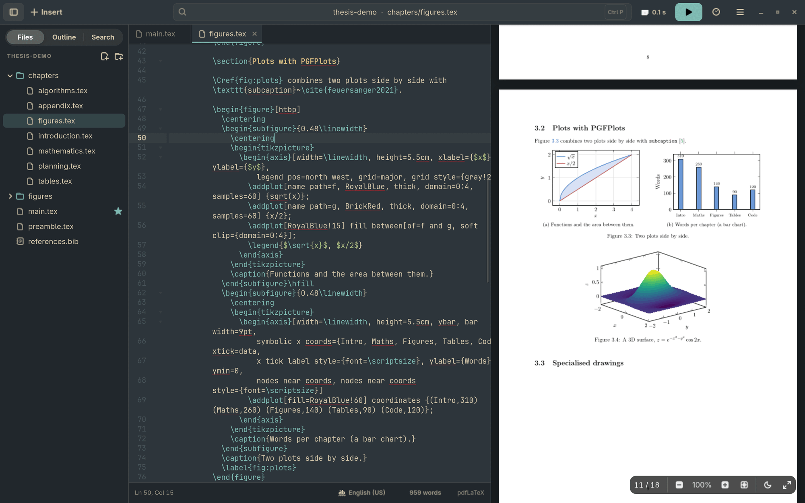
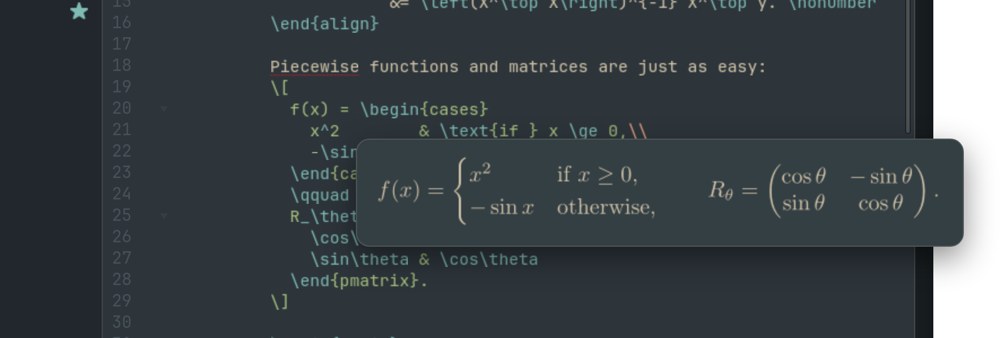
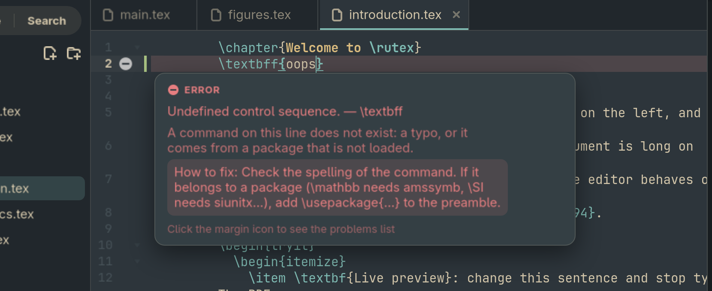
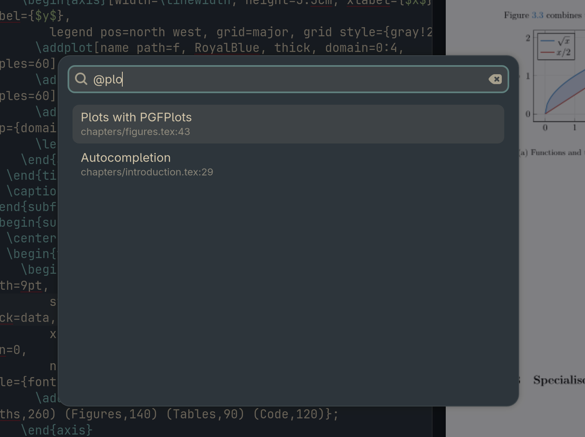
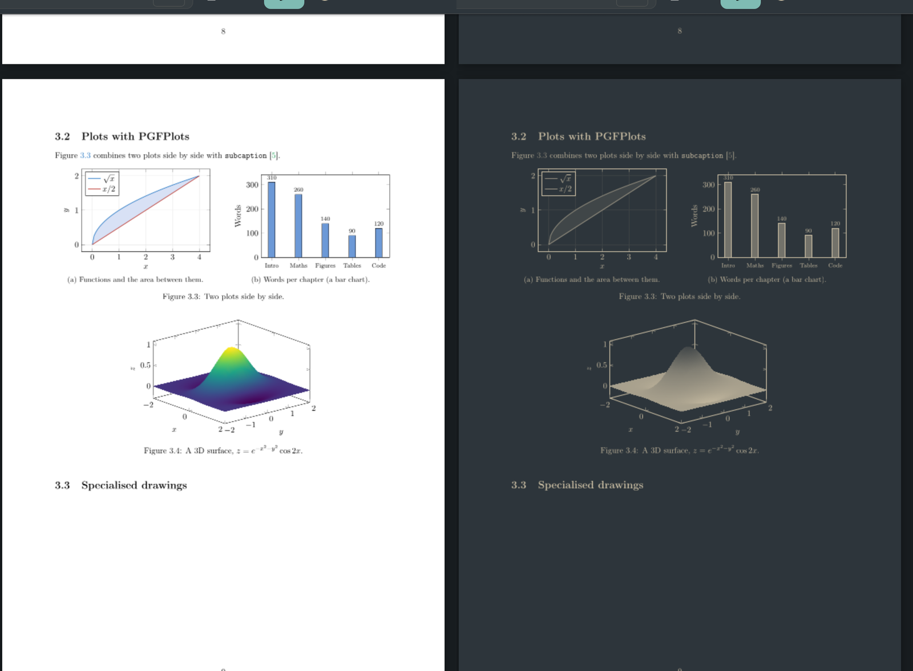

<div align="center">


# rutex

**A fast, native LaTeX editor for Linux, written in Rust.**

Open a project, type, and the PDF updates next to your code.<br/>
No subscription, no project limits, no Docker, nothing left running in the background.


[Features](#features) · [Install](#install) · [Shortcuts](#keyboard-shortcuts) · [Development](#development)

<br/>



<sub>The built-in demo project with the <a href="https://omarchy.org">Omarchy</a> theme.</sub>

</div>

## Why rutex

rutex gives you the comfortable parts of Overleaf without the limits that get in the way of a
real thesis:

| | Overleaf (free plan) | rutex |
| --- | :---: | :---: |
| Live PDF next to your code | ✅ | ✅ |
| Compile time limit | 10 seconds | **None** |
| Works offline, files stay on your machine | ❌ | ✅ |
| Subscription or project limits | Yes | **No** |
| Collaboration | Real-time, in the browser | Through Git ([Sync](#features)) |

It is built with GTK4 + libadwaita and made with [Omarchy](https://omarchy.org) (Arch + Hyprland)
in mind, but it runs on any modern Linux desktop. The interface is in English by default, and
Spanish is available in Preferences.

## Quick start

```bash
git clone https://github.com/fransandooo/rutex.git
cd rutex
./install.sh        # builds and installs into ~/.local, no sudo
rutex ~/thesis      # or open it from your app launcher
```

Don't have a project at hand? Press **Try the demo** on the welcome screen.
You need GTK4, libadwaita, GtkSourceView, Poppler and TeX Live first: see [Requirements](#requirements).

## A closer look

<table>
  <tr>
    <td width="50%" valign="top">
      
      <p align="center"><b>Formula preview on hover</b><br/><sub>Rendered with your own preamble and macros.</sub></p>
    </td>
    <td width="50%" valign="top">
      
      <p align="center"><b>Errors explained in plain words</b><br/><sub>What went wrong and how to fix it, offline.</sub></p>
    </td>
  </tr>
  <tr>
    <td width="50%" valign="top">
      
      <p align="center"><b>Quick open</b> · <code>Ctrl+P</code><br/><sub>Fuzzy search over files, or sections with <code>@</code>.</sub></p>
    </td>
    <td width="50%" valign="top">
      
      <p align="center"><b>Dark mode for the PDF</b><br/><sub>Pages repainted with your theme colors.</sub></p>
    </td>
  </tr>
</table>

## Features

### Editing

| Feature | What it does |
| --- | --- |
| **Live compilation** | Saves and compiles with `latexmk` when you stop typing. If you keep typing during a build, the next one is queued instead of killing it, so `.aux` files are never left corrupted. |
| **Autocompletion** | Commands with tab stops and whole environments after `\begin{`. It also completes your labels in `\ref{`, your `.bib` keys in `\cite{`, images in `\includegraphics{` and chapters in `\input{`. |
| **Editing shortcuts** | Comment lines, bold and italic, duplicate and move lines, auto-closing `{ [ ( $`, and `\end{…}` added when you press Enter after `\begin{…}`. |
| **Symbols and snippets** | A searchable symbol palette (<kbd>Ctrl+Shift+M</kbd>). Inside a formula, `@a` becomes `\alpha`, `@8` becomes `\infty` and `@/` a fraction. `BEQ` + <kbd>Tab</kbd> gives an equation, and so do `BAL`, `BIT`, `BEN`, `BFI`, `BTA`, `BCAS`… |
| **Folding** | An arrow in the margin folds a chapter, section or environment (<kbd>Alt+-</kbd> / <kbd>Alt++</kbd>, or <kbd>Ctrl+Alt+-</kbd> for every section). Folded text is only hidden, and going to a line inside it opens it. |
| **Spell checking** | As you type, in the document's language (from `babel` or `polyglossia`). It skips commands, math, labels, citation keys and file names. |
| **Word count** | Words per chapter and an optional word goal, from the status bar. |
| **Vim mode** | Optional, from Preferences. |

### Finding your way

| Feature | What it does |
| --- | --- |
| **Files and tabs** | Real folders, with a right-click menu to create, rename, move or trash files, set the main file, copy the path or show it in the file manager. Images and PDFs open with the system's default app. |
| **Outline** | The chapters and sections of the whole document, following `\input`, one click away. |
| **Quick open** | <kbd>Ctrl+P</kbd> searches files with fuzzy matching, or sections if you start with `@`. |
| **Find and replace** | Across the whole project (<kbd>Ctrl+Shift+F</kbd>). |
| **References at a glance** | Hover a `\ref` or `\cite` to see what it points to (the caption, section title or entry), and <kbd>Ctrl</kbd>+click it to go to the `\label` or the `.bib` entry. |

### Figures, tables and references

| Feature | What it does |
| --- | --- |
| **Formula preview** | Hover a formula to see it rendered with your own preamble and macros. |
| **Images** | Drag one onto the editor to get a complete `figure`. The file is copied into the project. |
| **Tables** | Paste cells from a spreadsheet to get a `table`, or use Insert → Table from CSV. |
| **DOI and arXiv** | Paste a DOI or arXiv id, and the entry is added to your `.bib` and cited. **Zotero** (with Better BibTeX) works too. |

### Errors and checks

| Feature | What it does |
| --- | --- |
| **Errors where they happen** | Lines with errors and warnings are marked in the editor. Hover one to read the message, or click its margin icon to open the problems list. |
| **Errors explained** | Hovering an error shows what it means and how to fix it, for the ~40 most common LaTeX errors and warnings, offline. The same help is behind the **?** next to each problem in the list. |
| **Check before submitting** | <kbd>Ctrl+Shift+R</kbd> lists undefined references and citations, labels never referenced, uncited entries, duplicate labels, text sticking into the margin (worst first) and to-do notes. Each one is clickable. |
| **Missing packages** | When a build fails because a `.sty` is missing, rutex tells you which package provides it (from TeX Live's own database, offline) and copies the `pacman` command. |
| **No compile timeout** | Overleaf's free plan stops compiling after 10 seconds. A thesis with plots and a bibliography easily needs more. |

### PDF viewer

| Feature | What it does |
| --- | --- |
| **Smooth reloads** | Only the visible pages are rendered, on a separate thread. The viewer doesn't flicker and keeps your scroll position when it reloads. |
| **SyncTeX** | Double-click (or <kbd>Ctrl</kbd>+click) the PDF to jump to the source line, and press <kbd>Ctrl+J</kbd> to jump from the source to the PDF. |
| **Clickable links** | The table of contents, `\ref`, `\cite` and URLs work like in any PDF viewer, with a back button to return. |
| **Fullscreen reading** | <kbd>F11</kbd> or the button in the viewer shows only the PDF, and <kbd>Esc</kbd> goes back. |
| **Dark mode** | The moon button repaints the pages with your theme colors. |

### Working with others and history

| Feature | What it does |
| --- | --- |
| **Sync through Git** | Works with GitHub, GitLab, Overleaf's Git access… In a repository with a remote, **Sync** commits your changes, brings in everyone else's and sends yours. If two people changed the same lines, rutex says so in plain words and takes you there. Keep the right text and Sync again. The network is only used when you press Sync. |
| **Export to Word** | ☰ → Export to Word, for supervisors who review in Word. Equations become real Word equations, references keep their numbers, and TikZ drawings, plots, Gantt charts and pseudocode become images. Needs `pandoc` (`sudo pacman -S pandoc-cli`). |
| **Version history** | <kbd>Ctrl+Shift+H</kbd> shows automatic versions saved while you work and named ones (<kbd>Ctrl+Shift+S</kbd>), with a readable diff and one-click restore. It is a private Git repository in `~/.local/share/rutex/history/`: nothing is written into your project and nothing leaves your machine. |

### Projects and looks

| Feature | What it does |
| --- | --- |
| **Showcase demo** | "Try the demo" on the welcome screen opens an 18-page project with TikZ, PGFPlots, circuits, trees, tables, algorithms, code listings, a Gantt chart and a bibliography. Its source is in [`demo/`](demo/). |
| **Templates** | Article, thesis (chapters, biblatex + biber), lecture notes, Beamer slides and empty. They follow the interface language, including `babel` and folder names. |
| **Automatic engine** | pdfLaTeX by default, and XeLaTeX for `fontspec`, `unicode-math` or `polyglossia`. The `% !TEX program` and `% !TEX root` magic comments and your `latexmkrc` are respected. |
| **Clean project folders** | Build files go to `~/.cache/rutex/`. |
| **Omarchy theme, live** | Change it with `omarchy-theme-set` and the interface and syntax colors update at once. On other desktops rutex follows the system's light or dark setting. |
| **Its own flat look** | Custom tabs, and a command center in the header that opens quick open. |

## Requirements

| Component | Minimum version |
| --- | --- |
| GTK | 4.14 |
| libadwaita | 1.5 |
| GtkSourceView | 5.4 |
| Poppler (glib) | 0.82 |
| TeX distribution | TeX Live with `latexmk` and `synctex` |
| Rust (to build) | 1.85 (edition 2024), via [rustup](https://rustup.rs) |

<details open>
<summary><b>Arch Linux / Omarchy</b></summary>

```bash
sudo pacman -S --needed gtk4 libadwaita gtksourceview5 poppler-glib \
  texlive-basic texlive-latex texlive-latexrecommended texlive-latexextra \
  texlive-fontsrecommended texlive-bibtexextra texlive-mathscience texlive-binextra \
  texlive-xetex texlive-luatex texlive-pictures biber
# Optional, for Spanish documents: texlive-langspanish
```

</details>

<details>
<summary><b>Fedora</b></summary>

```bash
sudo dnf install gtk4-devel libadwaita-devel gtksourceview5-devel poppler-glib-devel \
  texlive-scheme-medium latexmk biber
```

</details>

<details>
<summary><b>Debian / Ubuntu (24.04 or newer)</b></summary>

```bash
sudo apt install build-essential libgtk-4-dev libadwaita-1-dev libgtksourceview-5-dev \
  libpoppler-glib-dev texlive-latex-extra texlive-fonts-recommended texlive-xetex \
  texlive-luatex texlive-bibtex-extra latexmk biber
```

</details>

## Install

```bash
git clone https://github.com/fransandooo/rutex.git
cd rutex
./install.sh
```

This builds rutex in release mode and installs it into `~/.local`, so `sudo` isn't needed:

- the binary goes to `~/.local/bin/rutex`;
- a desktop entry and icon are added, so rutex shows up in your app launcher (on Omarchy,
  `Super+Space`).

| To… | Run |
| --- | --- |
| Update | `git pull && ./install.sh` |
| Uninstall | `./install.sh --uninstall` |

### Usage

Open it from the launcher, or from a terminal:

```bash
rutex ~/thesis          # open a project folder
rutex chapter.tex       # open a file (its project is detected)
```

The welcome screen lets you open a folder or start a new project. A new project gets a
`main.tex` template.

### Hyprland keybinding (optional)

Add this to `~/.config/hypr/bindings.conf`:

```
bindd = SUPER SHIFT, L, LaTeX, exec, omarchy-launch-or-focus dev.fran.Rutex "uwsm-app -- rutex"
```

## Keyboard shortcuts

Press `Ctrl+?` inside the app to see them all. The ones you will use most:

| Shortcut | Action |
| --- | --- |
| `Ctrl+S` / `Ctrl+Enter` | Save and compile now |
| `Ctrl+P` | Quick open (type `@` for sections) |
| `Ctrl+J` / `Ctrl+click` or double-click on PDF | Jump source → PDF / PDF → source |
| `Ctrl+F` / `Ctrl+Shift+F` / `Ctrl+G` | Find / find in project / go to line |
| `Ctrl+Shift+R` | Check before submitting |
| `Ctrl+Shift+H` / `Ctrl+Shift+S` | Version history / save a named version |

<details>
<summary><b>All shortcuts</b></summary>

| Shortcut | Action |
| --- | --- |
| `Ctrl+S` / `Ctrl+Enter` | Save and compile now |
| `Ctrl+P` | Quick open (type `@` for sections) |
| `Ctrl+J` / `Ctrl+click` or double-click on PDF | Jump source → PDF / PDF → source |
| Click on a PDF link | Follow it (contents, references, citations, URLs); the back button returns |
| `Ctrl+Z` / `Ctrl+Y` / `Ctrl+Shift+Z` | Undo / redo |
| `Ctrl+F` / `Ctrl+Shift+F` / `Ctrl+G` | Find / find in project / go to line |
| `Ctrl+Shift+H` / `Ctrl+Shift+S` | Version history / save a named version |
| `Ctrl+Shift+R` | Check before submitting |
| `Ctrl+click` on a `\ref` or `\cite` key | Go to its `\label` or `.bib` entry |
| `Ctrl+/` | Comment or uncomment lines |
| `Ctrl+B` / `Ctrl+I` | `\textbf{}` / `\textit{}` |
| `Ctrl+D` / `Ctrl+Shift+K` / `Alt+↑↓` | Duplicate / delete / move lines |
| `Ctrl+Space` | Show suggestions |
| `Ctrl+N` / `Ctrl+Shift+N` | New file / new project |
| `Alt+-` / `Alt++` | Fold / unfold the section or environment at the cursor |
| `Ctrl+Alt+N` | New window (launching rutex again does the same) |
| `Ctrl+Shift+E` / `Ctrl+Shift+O` / `F9` | Files / outline / toggle sidebar |
| `Ctrl+E` | Problems panel |
| `Ctrl++` / `Ctrl+-` / `Ctrl+0` / `Ctrl+wheel` | PDF zoom |
| `F11` / `Esc` | PDF fullscreen / back |
| `Ctrl+,` | Preferences |
| `Ctrl+W` / `Ctrl+Shift+W` / `Ctrl+Q` | Close tab / close window / quit |

</details>

## Resource usage and lifecycle

- rutex is a single process with a single instance: launching it again focuses the existing
  window.
- It uses no CPU when idle, because everything is event-driven and nothing polls.
- Closing the last window ends the process.
- Every build runs in its own process group with `PR_SET_PDEATHSIG`. Closing a window kills its
  build, and if rutex crashes the kernel kills `latexmk` with it. At worst, a `pdflatex` or
  `biber` run that was already in progress finishes on its own.
- The cache of rendered PDF pages is capped at 128 MB.

More details (in Spanish) are in [docs/DISENO.md](docs/DISENO.md).

## Development

```bash
cargo run -- path/to/project
cargo test                 # unit tests
cargo test -- --ignored    # also compiles every template (needs TeX Live)
RUTEX_DEV=1 cargo run      # separate instance that runs alongside the installed one
```

## License

GPL-3.0-or-later. rutex links against Poppler, which is GPL-licensed.
